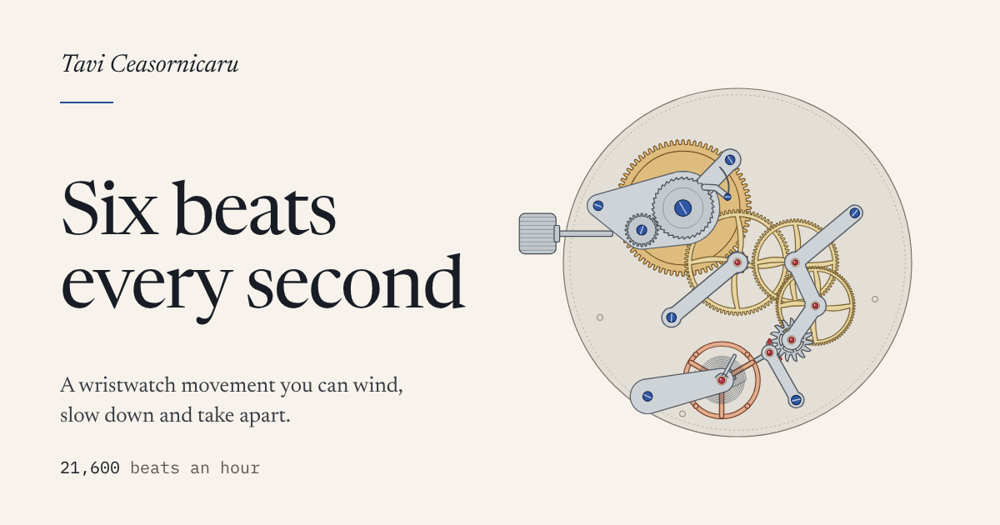

# tavi: Tavi Ceasornicaru

An interactive wristwatch movement on warm paper, for Tavi, who loves clocks and watches and mends wristwatches. You
wind it, slow it down and take it apart, one chapter at a time. English, light only, drawn rather than photographed.



Astro 7 · React 19 islands · Base UI · Tailwind 4 · three.js for the 3D movement · served under `/tavi`.

**Status:** built, with seven chapters, and not yet announced. The footer's line from Tavi is a dashed placeholder until
he sends it, and there is no contact line. [PRODUCT.md](PRODUCT.md) says who it is for and [DESIGN.md](DESIGN.md) holds
the design system. The approved sketch is the repo's [`design/tavi/`](../../design/tavi/README.md).

## The page

Chapters: 1 Energy (wind the mainspring, take the barrel apart), 2 Wheels (the train's ratios, then the dial side),
3 Escapement and 4 Balance (close-ups drawn by the clock), 5 Together (the whole movement in 3D, taken apart in seven
steps with labels), 6 The bench (Tavi's tools at real size) and 7 Repairs, the footer. The header has a global Pause and
a Sound toggle; the tick is synthesised and off until you press it.

## Run it

This site is an npm workspace: install once at the repo root (`npm install`). From the root:

```bash
npm run tavi:dev       # the dev server
npm run tavi:build     # the static build into sites/tavi/dist/
npm run tavi:preview   # serve the build
npm run tavi:og        # regenerate the social card
```

Build it for the sub-path the VPS serves:

```bash
PUBLIC_BASE=/tavi npm run tavi:build
```

The canonical, `og:url` and the card's `og:image` use `PUBLIC_SITE` as the origin. Without it they fall back to
`https://example.com`. A deploy is an owner step.

## One part table, two renderers

The movement is one typed table in [`src/movement/`](src/movement/): positions, tooth counts, pitch radii and the
clock, `stateAt(t)`, a pure function of time for a 21,600 vph train (six beats a second). Astro components draw it as SVG
at build time, so every chapter's figure is already on the page before any script runs. The three.js island in
[`src/three/`](src/three/) builds the same table in 3D and takes its outlines from the drawing's own builders, so its
first frame matches the drawing. Chapter 6's tools are a second typed table in [`src/bench/`](src/bench/). Colours are
tokens in `src/styles/global.css`; three.js reads the part colours from the stylesheet at runtime.

## When 3D is not available

1. WebGL 2: the 3D movement replaces the drawing on the hero and in chapter 5, in the same box, and opens flat.
2. A phone that reaches chapter 5 before the hero has loaded three.js: the drawing stays and "Turn it in 3D" loads it.
3. No WebGL, or a lost context: the drawing, taken apart through its lift groups.
4. Reduced motion: every figure starts paused on a still frame until its Pause is released.
5. No scripting: the still drawings, all the prose and every chapter link.

## Checks

```bash
npm run tavi:test                              # node:test on the part table, the clock, the drawings and the labels
npm run check                                  # at the root: typecheck, lint, format, conventions, tests
npm run tavi:build && SITES=tavi npx playwright test -c e2e
```

The Playwright run covers the shared Floor checks, the phone menu's spec and `e2e/tavi.spec.ts`; the contrast check
reads the built site, so build first.

## The social card

`public/images/og-image.png` (1200 x 630, under 300 KB) is the hero's drawing on paper with the wordmark.
[`scripts/gen-og.mjs`](scripts/gen-og.mjs) builds [`scripts/og-card.html`](scripts/og-card.html) from the part table and
the stylesheet's tokens, screenshots it in headless Chrome (`CHROME=/path/to/chrome` picks the binary) and writes the
PNG with sharp. Run `npm run tavi:og` after a change to the drawing or a part colour.

## Why English, and no docs site

Every other site here is Romanian; Tavi's is English because the owner chose it
([decisions-tavi.md](../../corpus/wiki/decisions-tavi.md)). It has no docs site yet: this README, PRODUCT.md and
DESIGN.md are its docs, and the repo's [docs/](../../docs/README.md) lists it with the other sites.
